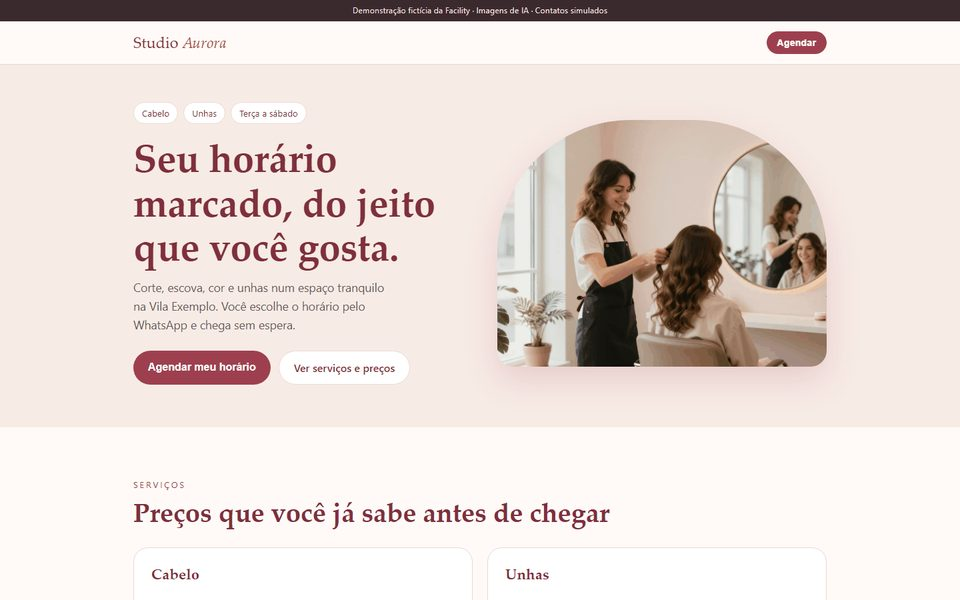

# Sites, vídeo e automação · Fabio Rabelo

Três conceitos fictícios para negócios locais, com identidade própria, preços ilustrativos e botões de contato que mostram apenas um aviso local. Não há envio de mensagens, pedidos ou reserva de horários.

**[Ver ao vivo →](https://fabiorabeloj.github.io/portfolio-sites/)**

| [Barbearia Brasa](https://fabiorabeloj.github.io/portfolio-sites/barbearia.html) | [Studio Aurora](https://fabiorabeloj.github.io/portfolio-sites/salao.html) | [Chapa Quente](https://fabiorabeloj.github.io/portfolio-sites/hamburgueria.html) |
|---|---|---|
|  |  |  |
| Barbearia: hora marcada, tabela de preços, tema escuro | Salão: serviços por categoria, horários, tema claro | Hamburgueria: cardápio, horário, pedido rápido |

> Negócios fictícios. As fotos foram geradas por IA e os contatos são simulados: os botões mostram um aviso em vez de abrir o WhatsApp ou o mapa.

## Como foram feitos

- HTML, CSS e JavaScript puros, sem framework e sem etapa de build.
- Pensados primeiro para o celular; capturas completas em 390 px e 1440 px na pasta [`capturas/`](capturas/).
- Cada página tem chamada principal visível na primeira tela, preços ou cardápio sem precisar perguntar e, no fim, horário e informações de atendimento.

## Rodar localmente

```sh
python -m http.server 8000 --bind 127.0.0.1
```

Abra http://127.0.0.1:8000. Encerre com `Ctrl+C`. As páginas também abrem diretamente no navegador. Não há build, instalação npm, API, banco ou chave para estes três conceitos.

## Verificar e reproduzir

```sh
python tools/verificar.py
```

Python 3.10+ e biblioteca padrão. O comando confere os hashes de proveniência e recursos locais dos quatro HTML. Não substitui testes de interação, revisão visual ou acessibilidade completa. [Dependências](docs/DEPENDENCIAS.md) · [Proveniência e atribuições](docs/PROVENIENCIA.md).

## Vídeo e automação

| Projeto | Abrir | Reproduzir e conferir |
|---|---|---|
| Chapa Quente: motion design de 18 s sobre duas imagens de IA, com áudio original | [MP4](examples/video/chapa-quente-18s.mp4) · [quadros](examples/video/contato-quadros.jpg) | [Fontes, dependências e direitos](examples/video/README.md) |
| Pedidos em ordem: validar, normalizar e deduplicar CSV fictício | [Relatório interativo](https://fabiorabeloj.github.io/portfolio-sites/examples/automation/demo/resultado/relatorio.html) | [Código, fixture, 14 testes e reprodução](examples/automation/README.md) |

Na pasta `examples/automation`, execute `python -X utf8 -B demonstrar.py` para processar a mesma fixture duas vezes e comparar os resultados. Requer Python 3.12+, sem pacotes adicionais. As 12 linhas se dividem em quatro pedidos prontos, três duplicatas e cinco linhas para revisão. Não há envio, ERP, agenda ou conta real.

O vídeo é composição sobre imagens estáticas, com aviso de demonstração persistente. Não representa filmagem, campanha ou resultado comercial. As fontes do Windows e os binários de edição não são distribuídos. A origem declarada das imagens e os limites da evidência estão nos manifestos de cada pacote; não se promete exclusividade.

O verificador da raiz também confere os manifestos SHA-256 dos exemplos incluídos. [Critérios de incorporação](docs/INTEGRACAO.md).

---

**English:** three sample websites for local businesses (barber shop, beauty salon and burger place). Plain HTML/CSS/JavaScript, mobile-first, with clear pricing and a one-tap call to action. Fictional businesses, AI-generated photos and simulated contacts. [Live demo](https://fabiorabeloj.github.io/portfolio-sites/).

Código original sob licença [MIT](LICENSE), com os avisos próprios de cada exemplo. Essa licença não se estende às imagens ou fontes por suposição. Feito por [Fabio Rabelo](https://github.com/fabiorabeloj).
