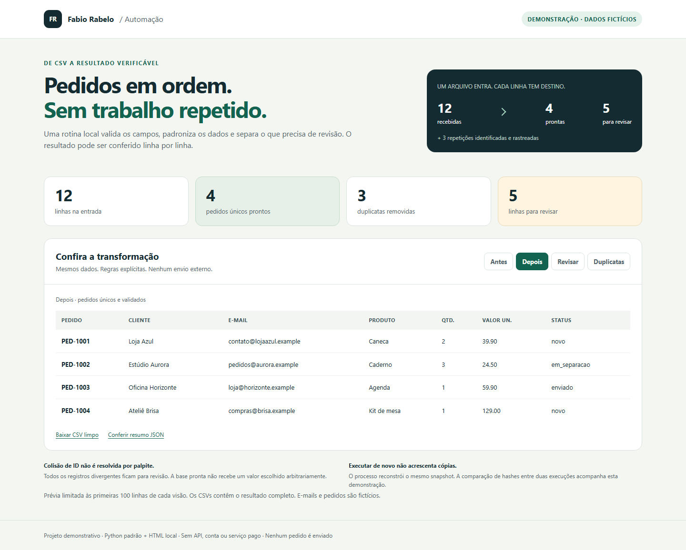

# Pedidos em ordem

Demonstração de automação local para organizar uma planilha de pedidos.
**Dados inteiramente fictícios. Nenhum pedido ou contato é enviado.**



O exemplo recebe 12 linhas e entrega:

| Destino | Quantidade | Evidência |
|---|---:|---|
| Pedidos únicos e validados | 4 | `demo/resultado/pedidos_limpos.csv` |
| Duplicatas idênticas após normalização | 3 | `demo/resultado/duplicatas.csv` |
| Linhas para revisão | 5 | `demo/resultado/revisar.csv` |

As cinco linhas de revisão são três registros com campos inválidos e duas
linhas com o mesmo ID e valores diferentes. Nenhum valor é escolhido por palpite.
Todas as 12 linhas têm um destino rastreável. O resumo confere o total fictício
dos quatro pedidos prontos: 342,20. Isso não é faturamento real.

## Executar

Requer **Python 3.12 ou superior**, sem pacotes adicionais, API, conta ou internet.
Na pasta do projeto:

```console
python -X utf8 -B demonstrar.py
```

O comando executa a CLI duas vezes. Abra `demo/resultado/relatorio.html` no
navegador. Os botões Antes, Depois, Revisar e Duplicatas permitem conferir a
transformação. Os downloads apontam aos arquivos locais ao lado do HTML.
No celular, as tabelas têm rolagem horizontal.

Para processar um CSV com o mesmo contrato:

```console
python -X utf8 -B automatizar.py --entrada fixtures/pedidos_ficticios.csv --saida demo/resultado
```

É possível juntar até dez CSVs na mesma execução:

```console
python -X utf8 -B automatizar.py --entrada lote_a.csv lote_b.csv --saida minha_saida
```

Use arquivos fictícios para reproduzir esta demonstração. A pasta de saída
deve ser nova ou pertencer a uma execução anterior desta demo. O programa
recusa sobrescrever arquivos de entrada ou uma pasta que não lhe pertence.
Os arquivos originais são preservados. Não há exclusão de registros na origem.

## Regras explícitas

- CSV UTF-8, com ou sem BOM, separado por `;`, no cabeçalho exato da fixture.
- ID no padrão `PED-` seguido de 4 a 12 dígitos; espaços externos e caixa são normalizados.
- Cliente/produto usam Unicode NFC e espaços padronizados; maiúsculas e acentos são preservados.
- E-mail vira minúsculas e passa por checagem sintática conservadora. Não há consulta ou verificação de entrega.
- Quantidade inteira de 1 a 9999. Valor positivo até 1.000.000, sem milhares, com até duas casas; aceita `R$`, vírgula ou ponto decimal. `1.234` é recusado por ambiguidade.
- Status aceitos: novo, em separação e enviado. Não se infere status desconhecido.
- ID igual com todos os valores normalizados iguais: mantém uma linha e registra as repetições.
- ID igual com divergência ou uma ocorrência inválida: as linhas válidas desse grupo também vão para revisão.
- Exportação de texto que parece fórmula recebe apóstrofo; o HTML escapa os valores. Isso não substitui uma revisão de segurança para produção.

## Segunda execução sem duplicação

O processo gera um **snapshot**, sem append e sem banco de dados. Com os mesmos
arquivos, na mesma ordem, reconstrói os mesmos resultados. `demonstrar.py`
compara SHA-256 de cada arquivo entre a primeira e a segunda execução.
`demo/comprovacao.json` registra os dois resultados e `arquivos_identicos: true`.
Não há tempo economizado ou ganho de produtividade inventado.

Essa prova cobre repetir a mesma entrada. Não implementa sincronização
incremental, atualização de pedidos anteriores ou conciliação com um ERP.

## Conferir

```console
python -X utf8 -B -m unittest discover -s tests -v
```

Os 14 testes cobrem campos, colisões, arquivos inválidos, codificação, fórmulas,
HTML, preservação de arquivos, trava concorrente, múltiplas entradas, CLI e
idempotência. `demo/interface-validacao.json` registra os cliques e contagens
das quatro visões. `VALIDACAO.json` resume os checks locais.

## Material para apresentação

- `capturas/before-1440.png`: entrada com repetições e inconsistências.
- `capturas/after-1440.png`: base limpa e resumo.
- `capturas/review-1440.png` e `capturas/duplicates-1440.png`: rastreio das exceções.
- `capturas/after-390.png`: visual no celular.
- `demo/demonstracao.mp4`: apresentação silenciosa de 20 segundos dos estados reais do relatório.

O vídeo foi montado de capturas do navegador local, com mudança de visão e
rolagem; não é gravação de uma integração em produção e não mede velocidade
de execução. Capturas/vídeo usam Edge, Playwright e FFmpeg já existentes no
ambiente de produção da amostra. Eles não são necessários para executar a CLI
ou abrir o relatório e não são redistribuídos neste projeto.

## Limites e licença

Limite da demo: 2 MB por arquivo, 10 arquivos e 10.000 registros no conjunto.
O HTML mostra até 100 linhas por visão; os CSVs contêm o resultado completo.
São regras demonstrativas, não um sistema de pedidos/CRM completo.

Uma trava evita duas gravações na mesma pasta. Cada arquivo de saída é
substituído individualmente; o conjunto de arquivos não é uma transação de
banco. Uma queda pode deixar resultados parciais e uma trava: confira o
processo antes de remover a trava e execute novamente, ou use uma pasta nova.
Não há agenda, serviço, OAuth ou ação em contas reais.

Código, layout e fixtures novos sob [MIT](LICENSE). Python é dependência externa
sob licença PSF; nenhuma biblioteca de terceiros é incorporada ao código.
Fontes/procedência em `FONTES.md`; hashes em `SHA256SUMS.txt`.
